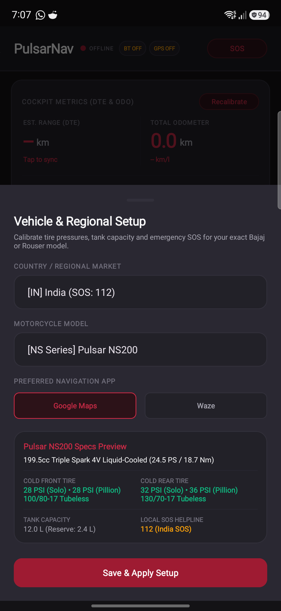
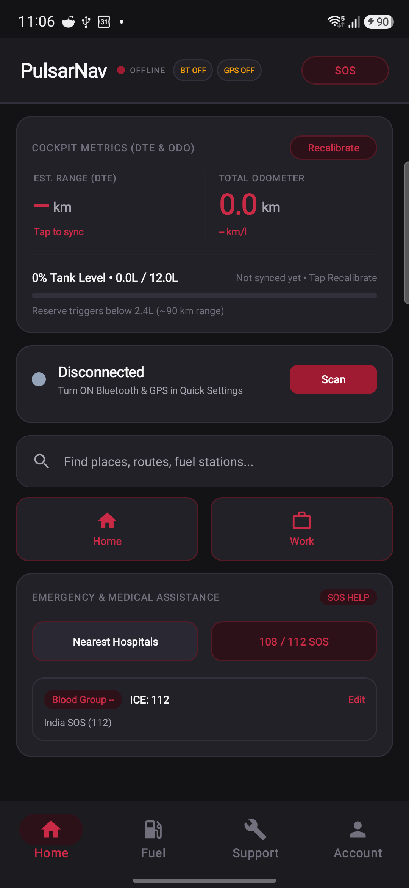
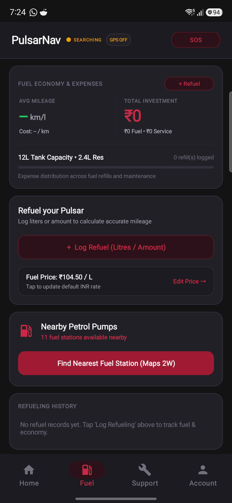
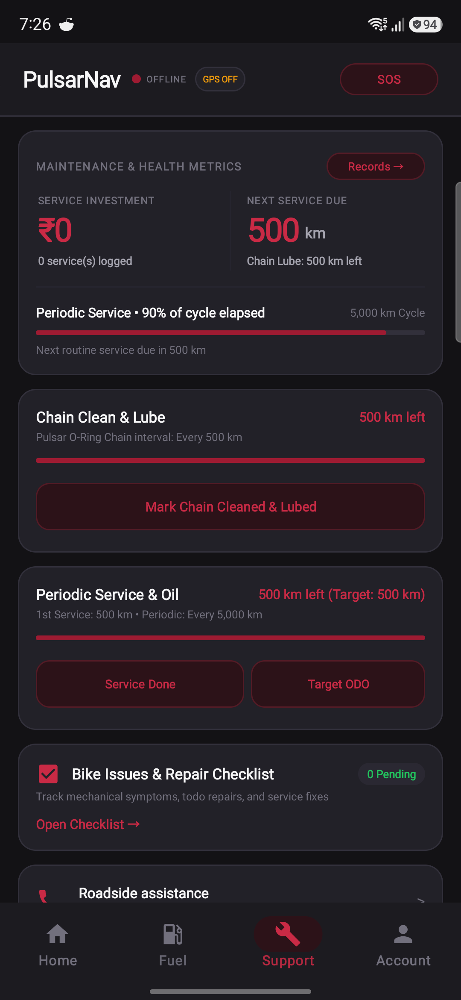
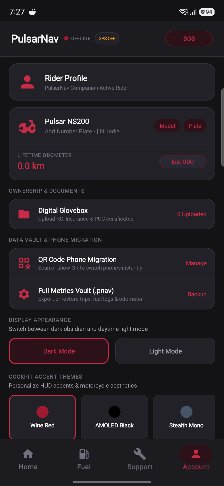
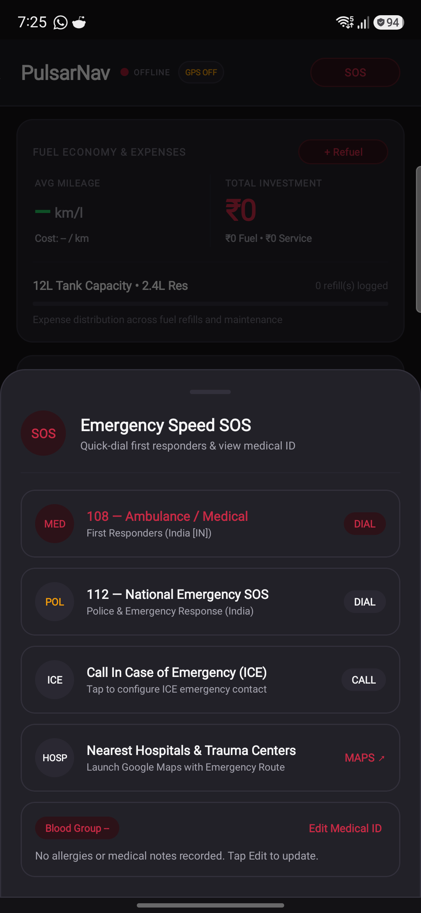

# PulsarNav

Turn-by-turn navigation bridge and companion app for Bajaj Pulsar and Dominar motorcycles.

[](https://github.com/Az-har/pulsarnav/releases/latest)
[](LICENSE)

> **Note**: This is a vibe-coded project built by a rider to solve real annoyances with the stock motorcycle cluster. Expect bugs, quirks, and rough edges. If something breaks or you want to improve it, feel free to open an issue or submit a pull request!

---

## Why this exists

Bajaj's newer digital instrument clusters (found on the 2024+ Pulsar NS200, N250, Dominar, etc.) have built-in Bluetooth and turn-by-turn navigation screens powered by OTC Engineering. But the official companion app has its own issues, proprietary routing, and missing features.

PulsarNav is an open-source, offline companion app that intercepts turn instructions directly from **Google Maps** or **Waze** and sends them over Bluetooth Low Energy (BLE) to your bike's console in real-time.

It runs locally on your phone. No logins, no cloud servers, no analytics trackers, and no internet required (outside of your navigation app).

---

## Supported Bikes

Compatible with Bajaj and Rouser models equipped with the OTC Engineering digital Bluetooth cluster:

- Bajaj Pulsar NS200 (2024+ digital cluster)
- Bajaj Pulsar NS400Z (5" TFT cluster — BLE TBT, telemetry, calls, music metadata & switchgear)
- Bajaj Pulsar N250 / F250
- Bajaj Pulsar NS160 / NS125
- Bajaj Dominar 400 / Dominar 250
- Bajaj Rouser NS200 / N250 (Latin America)

---

## What it can do

- **Turn-by-Turn Navigation**: Works with Google Maps (two-wheeler mode) or Waze. Turn arrows and distance countdowns appear on the cluster as you ride.
- **Android Auto & Open Headunit Support**: If you use a secondary phone on your handlebar running Android Auto (via Open Headunit or Headunit Reloaded), you can toggle "Skip Cluster Nav with Headunit" in settings so the bike cluster stays quiet while your screen handles the map.
- **Caller ID & Handlebar Controls**: Shows who is calling on the cluster. Single-press the handlebar button to answer, or long-press to reject/end calls. When not in a call, the button controls music (play/pause and next track).
- **Service & Maintenance Tracking**: Keeps track of your odometer, 500 km chain cleaning reminders, and first/periodic oil services with custom target ODOs.
- **Bike Repair Checklist**: A simple todo list to write down mechanical issues, strange vibrations, or parts to fix at the next service.
- **Fuel Logging & Range**: Log refuels with your local currency and custom fuel rates to calculate real km/l mileage and distance-to-empty.
- **Digital Glovebox**: Store copies of your RC, insurance, and PUC locally so they are easily accessible on your phone without network coverage.
- **Backup & Restore**: Export your full history to an AES-256-GCM encrypted `.pnav` file (or `.pnav.json`) or transfer settings to a new phone via QR code.
- **Dark & Light Mode**: Includes dark and light themes with multiple accent colors (Wine Red, AMOLED Black, Stealth, Amber, Mint, Blue, Custom RGB).

---

## Screenshots

| Bike Setup | Home & Navigation | Fuel & Range Analytics |
| :---: | :---: | :---: |
|  |  |  |

| Chain Lube & Service | Vehicle & Data Vault | Emergency SOS & ICE |
| :---: | :---: | :---: |
|  |  |  |

---

## How it works

The app does not use any private APIs or cloud integrations:

1. You start navigation in Google Maps or Waze.
2. Android posts ongoing turn directions to the notification bar.
3. PulsarNav reads the notification maneuver icon and distance countdown.
4. It packs the instruction into a 48-byte OTC Bluetooth telematics frame.
5. It writes the packet over BLE to the motorcycle cluster.

```
Google Maps / Waze  -->  Notification Listener  -->  48-byte OTC Frame  -->  BLE GATT  -->  Bike Cluster
```

---

## Bluetooth Protocol Details

For anyone interested in the telematics or contributing:

- **Service UUID**: `0010676e-6972-6565-6e69-676e4543544f`
- **TBT Navigation Characteristic**: `0110676e-6972-6565-6e69-676e4543544f` (Write)
- **Status / Heartbeat Characteristic**: `0210676e-6972-6565-6e69-676e4543544f` (Write)
- **Missed Call Characteristic**: `0310676e-6972-6565-6e69-676e4543544f` (Write)
- **Alerts Characteristic**: `0410676e-6972-6565-6e69-676e4543544f` (Write)
- **Music Info Characteristic**: `0610676e-6972-6565-6e69-676e4543544f` (Write — 111-byte TFT track metadata)
- **Handlebar Button Characteristic**: `0a10676e-6972-6565-6e69-676e4543544f` (Notify / Read)

### 48-Byte Navigation Frame

| Bytes | Purpose | Description |
| :--- | :--- | :--- |
| `0x00` | Flags | `bit0`=type (`1` active, `0` stop), `bit4`=step-unit (`1` m, `0` km), `bit7`=ETA PM |
| `0x01` | Maneuver Opcode | Turn arrow ID (`66..90`, `+32` blink variant when `< 100m`) |
| `0x02` - `0x05` | Step Distance | Little-endian decimal hundredths & integer (`fLow, fHigh, iLow, iHigh`) |
| `0x06` | ETA Minute | Minutes (`0..59`) |
| `0x07` | ETA Hour / Exit | `bits 0..3` ETA Hour (`1..12`), `bits 4..7` roundabout exit (`0..8`) |
| `0x08` - `0x0B` | Total Distance | Little-endian decimal hundredths & integer (`fLow, fHigh, iLow, iHigh`) |
| `0x0C` | Total Flags | `bit0`=total-unit (`1` m, `0` km), `bits 2..3`=GPS active (`1`) |
| `0x0D` | Reserved Ack | `takeMeHome` ack (`0x00`) |
| `0x0E` | Street Length | ASCII string length ($N \le 31$) |
| `0x0F` - `0x2D` | Street Name | ASCII street / instruction text (up to 31 bytes) |
| `0x2E` | Unused | Zero padding (`0x00`) |
| `0x2F` | Checksum | Sum of bytes `0..46` modulo 256 |

---

## Setup & First Ride

1. Install the APK on your phone.
2. Open PulsarNav and pick your bike model and country.
3. Tap **PERMS NEEDED** or follow the prompt to enable **Notification Access** so the app can read navigation cues.
4. Turn on your motorcycle ignition key.
5. Tap **Scan** in PulsarNav, select your bike, and pair.
6. Open Waze or Google Maps, start navigation, and your cluster will mirror the turns.

---

## Building from source

### Prerequisites
- JDK 17
- Android SDK (API 34)

### Build APK
```bash
git clone https://github.com/nikhilmaity00/pulsarnav.git
cd pulsarnav
./gradlew assembleRelease
```
The compiled APK will be at `app/build/outputs/apk/release/app-release.apk`.

---

## Contributing

Contributions from fellow riders are welcome! Whether you are adding support for another Bajaj/Rouser model, improving navigation heuristics, or fixing a bug:

1. Fork the repository and create your feature branch (`git checkout -b feature/my-feature`).
2. Verify local builds and tests pass with `./gradlew assembleRelease testDebugUnitTest lintDebug`.
3. Submit a Pull Request.

Direct pushes to `master` are protected. All contributions are reviewed and merged via PRs by [@nikhilmaity00](https://github.com/nikhilmaity00). See [CONTRIBUTING.md](CONTRIBUTING.md) for complete details.

---

## Legal & Trademark Notice

PulsarNav is an independent, community open-source project and is not affiliated with, endorsed by, or sponsored by Bajaj Auto Limited, OTC Engineering, Google, or Waze. All brand and vehicle names (Bajaj, Pulsar, Dominar, Rouser, Google Maps, Waze) belong to their respective owners and are used strictly for compatibility identification under nominative fair use. Clean-room implemented with zero proprietary code or assets from OEM applications.

## License

MIT License. See [LICENSE](LICENSE) for details.
